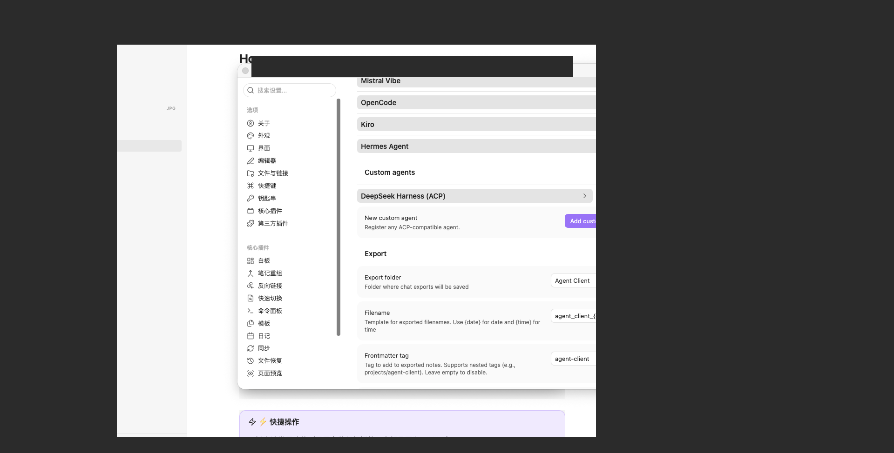
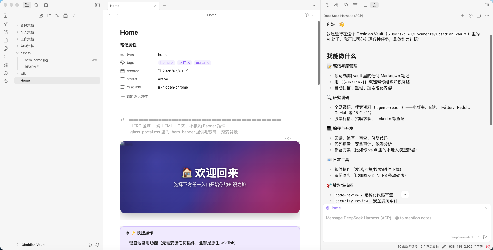
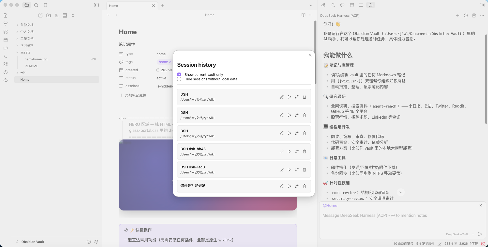

# obsidian-dsh-acp

[English](README.md) · [简体中文](README.zh-CN.md) · **Русский**

[](https://www.npmjs.com/package/obsidian-dsh-acp)
[](https://www.npmjs.com/package/obsidian-dsh-acp)
[](LICENSE)
[](package.json)
[](https://github.com/deepseek-ai/deepseek-harness)

> Запускайте **[DeepSeek Harness (DSH)](https://github.com/deepseek-ai/deepseek-harness)**
> прямо в **[Obsidian](https://obsidian.md)** — ACP-адаптер, превращающий
> Obsidian в полноценный клиент DSH.

## Что это?

`obsidian-dsh-acp` — это **[ACP (Agent Client Protocol)](https://github.com/evalstate/agent-client-protocol)**
-сервер, связывающий DSH с Obsidian. Добавьте его как *Custom Agent* в плагин
**Agent Client** для Obsidian (или установите как cordis-плагин в профиль DSH) — и вы
сможете управлять DeepSeek Harness прямо из Obsidian: диалоги, инструменты, история
сессий — не выходя из приложения.

```text
Obsidian (плагин Agent Client)
      │  ① запускает его как Custom Agent по ACP
      ▼
obsidian-dsh-acp (ACP-сервер, v1 over stdin/stdout)
      │  ② одна инструкция за ход
      ▼
dsh  (одноразовая задача headless или долгоживущий шлюз dsh web)
```

Работает так же, как `claude-agent-acp` для Claude Code: каждый ход транслирует вывод
DSH обратно в клиент как обновления `agent_message_chunk` и завершается результатом
`end_turn`.

## Возможности

- 💬 **Диалог внутри Obsidian** — отправляйте запросы в DSH из боковой панели Agent Client.
- 🧰 **Карточки вызова инструментов** — инструменты отображаются в клиенте
  (`in_progress` → `completed`) с расходом токенов на каждом шаге. *(нужна модель с
  поддержкой инструментов)*
- 🗂️ **Управление сессиями** — постоянный список сессий, **fork**, **resume** и
  **безвозвратное удаление**; сохраняются между перезапусками адаптера.
- 🔀 **Смена модели на сессию** — выпадающий список моделей в клиенте; выбранная модель
  применяется только к этой сессии (общая конфигурация профиля не меняется).
- 🧠 **Рассуждения и поток в реальном времени** — в режиме long (внутри профиля dsh web).
- 📥 **Импорт внешних сессий** — импорт сессии, экспортированной другим ACP-агентом
  (например, Claude / Agent Client), в локальное хранилище сессий DSH.
- 🩺 **Самопроверка и починка в один клик** — `dsh-acp doctor` диагностирует отклонения
  окружения и устраняет большинство проблем автоматически.
- 🧹 **Автоочистка** — «осиротевшие» сессии выверяются по списку сессий Obsidian
  (консервативно; живые сессии никогда не удаляются).

## Скриншоты

Зарегистрирован как пользовательский агент, диалог и история сессий — всё внутри
Obsidian Agent Client:





## Требования

- **Node.js >= 22.13**
- Запускаемый бэкенд **`dsh`** (см. [Загрузка профиля headless](#загрузка-профиля-headless))
- **Obsidian** с плагином **Agent Client** (для пути через Obsidian)

## Установка

### В один клик (рекомендуется)

Пакет поставляет параметризованный установщик: он (a) ставит плагин в профиль DSH через
официальный `dsh plugin add` и (b) подключает пользовательский агент **Agent Client** в
Obsidian к ACP-серверу. Он **идемпотентен**, **создаёт резервные копии** файлов перед
изменением, поддерживает **любой vault Obsidian** и умеет предпросмотр `--dry-run`.

```bash
# сначала предпросмотр (ничего не меняет)
./install.sh --obsidian-vault /path/to/any/vault --dry-run

# установка в профиль "web" + подключение Obsidian
./install.sh --obsidian-vault /path/to/any/vault

# в другой профиль / без Obsidian
./install.sh --profile headless --obsidian-vault /path/to/any/vault
./install.sh --no-obsidian
```

Все опции — `./install.sh --help` (`--profile`, `--dsh-home`, `--package`,
`--node-bin`, `--dry-run`, `--uninstall`, …).

**Windows:** используйте версию для PowerShell — `.\install.ps1 -ObsidianVault 'D:\path\to\vault'`
(добавьте `-DryRun` для предпросмотра, `-Uninstall` для отката). Она записывает
`DSH_BIN`, указывающий на шим `dsh.cmd`, и разделяет профиль-цель плагина и профиль
среды выполнения адаптера.

### Вручную (Obsidian Agent Client)

1. Установите и включите плагин сообщества **Agent Client**
   (Settings → Community plugins → Browse → "Agent Client").
2. Settings → **Custom Agents** → **Add** и заполните:
   - **ID**: `dsh-acp`
   - **Display name**: `DeepSeek Harness (ACP)`
   - **Command**: абсолютный путь к `dsh-acp.mjs` этого пакета
   - **Args**: *(пусто)*
3. Укажите в **`nodePath`** плагина реальный `node` (>= 22.13).
4. Перезагрузите Obsidian (`Cmd/Ctrl-R`) и выберите *DeepSeek Harness (ACP)* в списке агентов.

> **`customAgent.env` — это массив объектов `{ key, value }`, а не строки `"KEY=VALUE"`.**
> Agent Client строит окружение дочернего процесса из этого массива; простая строка
> игнорируется.

## Быстрый старт

1. Перед первым запросом **выберите модель с поддержкой инструментов** (например,
   `gemini-2.5-pro`) и убедитесь, что для неё настроен действующий API-ключ. Карточки
   вызова инструментов появляются только у моделей, поддерживающих вызов функций.
2. Отправьте запрос. DSH выполнит ход и вернёт ответ в Obsidian.

Если первый запрос падает с `AUTH: Authentication Fails` или ничего не возвращает —
модель по умолчанию либо не поддерживает инструменты, либо не имеет учётных данных;
выберите настроенную модель в списке и повторите.

## Использование

```bash
dsh-acp                       # запустить ACP-сервер (по умолчанию)
dsh-acp doctor                # проверка здоровья + рекомендации по починке
dsh-acp import <file>         # импорт JSON внешней ACP-сессии
dsh-acp manage <verb> ...     # list / export / archive / move / import сессий
dsh-acp --help                # полная справка
```

### Проверка и починка (`doctor`)

Когда DSH или Obsidian сообщает о проблеме соединения («ACP connection closed»,
«dsh exited 1», `MISSING_CREDENTIAL`, …), выполните:

```bash
dsh-acp doctor                  # диагностика + готовые к вставке команды починки
dsh-acp doctor --repair         # полная починка самопроверки — ПРЕДПРОСМОТР (без записи)
dsh-acp doctor --repair --apply # применить (каждый файл сначала резервируется)
```

`doctor` **не зависит от версии**: только общие проверки (бинарь dsh, версия dsh,
учётные данные, здоровье профиля headless), без обращения к внутренним API конкретной
версии dsh.

### Резервный текст для хода «только инструменты»

Модели с рассуждениями иногда вызывают инструмент, но **не выводят текст для
пользователя** (весь ответ остался в потоке рассуждений). Без этого клиент показал бы
только карточку инструмента и пустой ответ. Чтобы этого избежать, `dsh-acp`
синтезирует правдивое уведомление, и ход всегда что-то показывает:

```
[模型请求调用工具：<имена инструментов>；当前运行模式不执行工具，本轮无结果与文字]
```

Это **только отображение** — не меняет протокол и архивную историю. Отключается через
`DSH_ACP_TOOL_ONLY_FALLBACK=off`.

**Гейт инструментов на пути proxy/long (по умолчанию ВЫКЛ).** Путь proxy/long делает
один вызов `ctx.llm.stream()` и **не имеет исполнителя инструментов**. Экспорт схем
инструментов там заставлял модель запрашивать неисполняемые инструменты и заканчивать
ход без текста. Поэтому схемы инструментов там **не экспортируются** по умолчанию:

```bash
DSH_ACP_LONG_TOOLS=1 dsh-acp ...   # включить (задать в окружении процесса dsh web)
```

Нужно реальное выполнение инструментов? Используйте путь **spawn** (уберите
`DSH_ACP_HTTP_GATEWAY_URL`, задайте `DSH_ACP_PROXY_MODE=false`) — у настоящего backend
`dsh` есть свой agent loop.

**Необязательная подсказка о завершающей фразе (по умолчанию ВЫКЛ).** Включите, чтобы
модель дописывала короткую завершающую фразу после вызова инструмента:

```bash
DSH_ACP_CLOSING_REPLY_NUDGE=1 dsh-acp ...
```

При включении к отправляемому запросу добавляется короткая инструкция («после вызова
инструмента расскажи пользователю, что сделал»). Подсказка видна только модели — она
никогда не показывается как текст пользователя.

> ⚠️ Включение меняет префикс запроса на каждом ходу с инструментами → **промах
> кэша запроса** → рост стоимости. Оставляйте ВЫКЛ, если не понимаете компромисс.
> Текст подсказки можно переопределить в `DSH_ACP_CLOSING_REPLY_NUDGE_TEXT`.

> **Инструменты памяти на пути proxy не выполняются** (нет исполнителя), а профиль
> headless не загружает `ui-obsidian-memory`. Воспоминание внутри сессии работает
> (история сессии); между сессиями — нет. См. `docs/known-gaps.md`.

### Очистка сессий (`gc`, автоматически)

Кнопка удаления в Obsidian удаляет только её локальный файл сессии и никогда не
отправляет ACP `session/delete` — поэтому постоянный индекс адаптера устаревает, и
удалённая сессия может «вернуться». Адаптер выверяет индекс при каждом `session/list`
(консервативно — сессии, ещё присутствующие в Obsidian, никогда не удаляются).

```bash
dsh-acp doctor         # показывает найденные каталоги сессий Obsidian + число сирот
dsh-acp doctor --gc    # запустить очистку сейчас
```

| Переменная | По умолчанию | Значение |
|---|---|---|
| `DSH_ACP_GC` | `on` | `off` отключает авто-GC |
| `DSH_ACP_GC_REPORT_ONLY` | `0` | `1` = только отчёт, без удаления (dry-run) |

## Конфигурация

### Транспорт Obsidian ↔ адаптер (proxy vs spawn)

Адаптер выбирает транспорт для каждого запроса:

- **proxy** *(рекомендуется, когда работает шлюз dsh web)* — перенаправляет ход уже
  запущенному шлюзу по HTTP/SSE, один долгоживущий процесс обслуживает модель;
- **spawn** *(запасной)* — запускает собственный подпроцесс
  `dsh --profile headless "<prompt>"`.

Рекомендуемые записи `env` пользовательского агента:

| key | value | эффект |
|---|---|---|
| `DSH_ACP_HTTP_GATEWAY_URL` | `http://127.0.0.1:3080` | указать на шлюз dsh web |
| `DSH_ACP_PROXY_MODE` | `true` | запросить транспорт proxy |

Если не задано ни одного, адаптер использует **spawn (headless)** — для этого нужен
`dsh` CLI в системе (`DSH_ACP_SPAWN_PROFILE` переопределяет профиль; по умолчанию
`headless`).

### Частые переменные окружения

| Переменная | Значение | По умолчанию |
|---|---|---|
| `DSH_BIN` | исполняемый файл `dsh` | `dsh` из PATH |
| `DSH_ACP_SPAWN_PROFILE` | профиль для транспорта spawn | `headless` |
| `DSH_ACP_DEFAULT_MODEL` | `provider/model` по умолчанию для новых сессий | *(профиль)* |
| `DSH_ACP_MODELS` | переопределить список моделей (`id(имя)` через запятую) | *(catalog)* |
| `DSH_ACP_PERMISSION_MODE` | `default` / `acceptEdits` / `dontAsk` / `bypassPermissions` | `default` |
| `DSH_ACP_LOG_DIR` | каталог лога времени выполнения | *(отключено)* |
| `DSH_ACP_STORE_DIR` | каталог постоянного JSON-индекса сессий | `~/.dsh-acp` |

<details>
<summary><b>Дополнительно →</b> полная таблица переменных окружения адаптера</summary>

| Переменная | Значение | По умолчанию |
|---|---|---|
| `DSH_PROFILE` | профиль для загрузки (другие компоненты) | — |
| `DSH_ARGS` | доп. аргументы перед запросом (через пробел) | *(нет)* |
| `DSH_ACP_LOG_MAX_BYTES` | лимит размера лога до ротации | `5242880` (5 MB) |
| `DSH_ACP_LOG_KEEP` | число хранимых ротированных логов | `2` |
| `DSH_ACP_PERSIST_DEBOUNCE_MS` | дебаунс записи индекса | `100` |
| `DSH_ACP_PERMISSION_TIMEOUT_MS` | таймаут авто-отклонения подтверждения | `300000` |
| `DSH_ACP_PERMISSION_EDIT_TOOLS` | инструменты класса «edit» | `Edit,Write,MultiEdit,NotebookEdit` |
| `DSH_ACP_RUNTIME_MODE` | явное переопределение `long` / `spawn` | *(авто)* |
| `DSH_ACP_SPAWN_FALLBACK` | откат к spawn при сбое long | `true` |
| `DSH_ACP_USE_OFFICIAL_BRIDGE` | попробовать официальный bridge dsh | `0` |
| `DSH_ACP_ARCHIVE_IN_MAIN` | архивы ходов в `sessions/` | `0` |

</details>

## Загрузка профиля headless

`dsh --profile headless` нужен провайдер модели по умолчанию, который он сможет
разрешить. Задайте профилю headless собственные настройки через **прямую** запись патча
`llm-pi-ai`:

- `~/.dsh/profiles/headless/cordis.patch.yml` — блок провайдера `llm-pi-ai` +
  `agent-default-model`, установленный в выбранный `provider/model`.
- `~/.dsh/profiles/headless/package.json` — `dsh-llm`, `dsh-agent-loop`, `dsh-acp`,
  `dsh-base`, `dsh-headless`, зафиксированные на версии вашего глобального `dsh`.
- `~/.dsh/profiles/headless/pnpm-workspace.yaml` — `overrides:` для пакетов
  `@deepseek-ai/dsh-*` + `allowBuilds:` для нативных модулей.

Проверьте через `dsh-acp doctor` — он сообщает о проблемах конфигурации профиля
headless с готовыми командами починки.

## Известные ограничения

- **Нет запросов разрешений на пути spawn** — там инструменты bash / записи файлов
  выполняются без диалогов подтверждения. Для подтверждений используйте
  `DSH_ACP_PERMISSION_MODE` (действует на пути long-runtime).
- **Официальный bridge dsh опционален и обычно недоступен** в профиле dsh web;
  адаптер автоматически откатывается к автономному пути spawn.

## Разработка

```bash
npm run test:unit       # юнит-тесты (node --test)
npm run test:protocol   # тест протокола ACP (spawn)
npm run test:long       # тест long-runtime
npm run test:all        # unit + protocol + long
```

## Лицензия

[MIT](LICENSE)

[acp]: https://github.com/evalstate/agent-client-protocol
[cordis]: https://github.com/cordiverse/cordis
